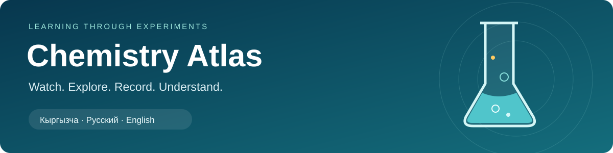
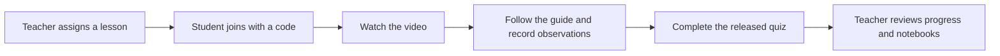
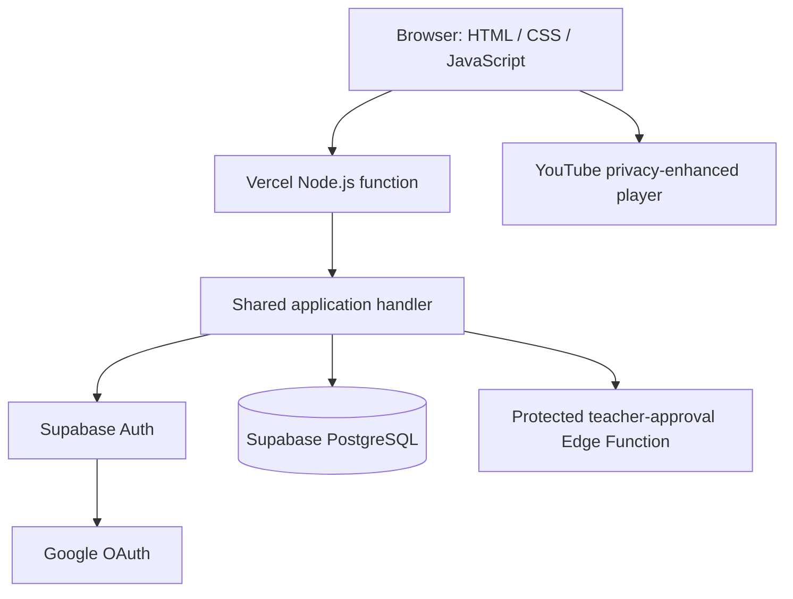

# Chemistry Atlas



**Watch an experiment. Record observations. Turn a lesson into learning.**

A multilingual chemistry learning platform for teachers and students in Kyrgyzstan. Video lessons, experiment guides, observation notebooks, and teacher-assigned quizzes come together in one classroom workflow.

[**Open the live website**](https://chemistry-atlas-delta.vercel.app/?lang=en) · [Account guide](ACCOUNTS.md) · [Deployment](LAUNCH.md) · [Security](SECURITY.md)


## Explore without an account

1. Open the [live website](https://chemistry-atlas-delta.vercel.app/?lang=en) and select **Sign in**.
2. Choose **Teacher Demo** to explore a sample classroom, assignments, rosters, and results.
3. Switch to **Student Demo** to open an assigned lesson and save observations below the video.

Each visitor receives an isolated sample workspace. Demo sessions expire after three hours and cannot access real classroom records. Google sign-in supports personal accounts; teacher privileges require approval.

## Features

| For learners | For teachers |
| --- | --- |
| Kyrgyz, Russian, and English interfaces and lesson guides | Separate teacher dashboard |
| 18 video lessons across 9 topics | Class codes, enrollment, and rosters |
| Search, video thumbnails, and honeycomb topic navigation | Teacher-controlled quiz release |
| Materials, safety, procedures, and observation tables beside the learning workflow | Due dates, late-submission settings, and archiving |
| Five-question quizzes for every lesson | Scores, submission status, and retake history |
| Downloadable HTML lesson sheets, printable to PDF | Saved student notebooks and teacher feedback |

### Classroom workflow



Quizzes require teacher release and video completion. The server checks trusted video durations, elapsed time, and signed receipts. These controls support the learning workflow; they cannot establish human attention or prevent every form of client manipulation.

## Engineering highlights

- **Google authentication with PKCE:** authorization-code exchange and secure, HttpOnly session cookies managed on the server through Supabase Auth.
- **Trusted roles and ownership checks:** teacher/admin privileges use server-controlled account metadata, with authorization on classroom operations.
- **Persistent learning records:** PostgreSQL stores enrollment, assignments, submissions, observations, feedback, and retake history.
- **Isolated demos:** separate records and signed visitor sessions let reviewers explore both roles without creating accounts.
- **Shared backend:** one application handler supports Vercel's Node.js runtime and the earlier Cloudflare Workers/D1 deployment.
- **Browser-native frontend:** HTML, CSS, and JavaScript, with a custom asset build and versioned frontend references.

## Architecture



Production uses a private `chemistry_atlas` schema and a dedicated application login. This login has application-table permissions, cannot read `auth.users`, and cannot create roles/databases or bypass row-level security. The server enforces classroom authorization; browsers do not directly access these private tables.

## Run locally

Use **Node.js 24** and npm. A Supabase project is required for real Google accounts; demos use the local database.

```bash
git clone https://github.com/MaahnoorRajan/chemistry-atlas.git
cd chemistry-atlas
npm ci
```

Copy `.env.example` to `.env.local` and configure your Supabase values. Keep Google credentials in Supabase's provider settings. Never commit real credentials.

```bash
npm run dev
```

Open **http://localhost:3000/?lang=en**. The development server creates `.local/atlas.sqlite` and applies migrations automatically. This local classroom database is separate from production. For local Google login, allowlist `http://localhost:3000/account/callback` in Supabase.

```bash
npm run check
npm run build
```

`check` validates the Vercel adapter's syntax. `build` compiles the shared handler and validates that every lesson has consistent five-question quizzes and localized lesson content. These commands do not replace browser and account-isolation testing.

## Repository map

| Path | Purpose |
| --- | --- |
| `api/index.js` | Vercel entry point |
| `dist/` | Editable frontend source, lessons, and public policy pages |
| `worker/` | Backend modules, build script, and local server |
| `worker/postgres.mjs` | PostgreSQL adapter |
| `worker/video-durations.json` | Trusted video durations |
| `drizzle/` | SQLite/D1 migrations |
| `postgres/schema.sql` | Bootstrap for a new PostgreSQL database |
| `supabase/functions/` | Protected teacher-approval function |

Despite its name, `dist/` contains the editable frontend source. Generated `dist/server/` output is ignored by Git. See [LAUNCH.md](LAUNCH.md) before provisioning a database; do not rerun the bootstrap on an existing database.

## Deployment and validation

Hosted on **Vercel Hobby**, with Supabase Auth and PostgreSQL. Commits to the connected GitHub `main` branch trigger deployment. Environment variables and callback configuration are documented in [LAUNCH.md](LAUNCH.md).

The November 20, 2026 release passed live checks for Google login, teacher/student demos, PostgreSQL notebook saves, assignment persistence, three-language responses, visitor isolation, unauthenticated API protection, and CSRF rejection. A separate local fixture suite covered all 18 quiz flows and account/session boundaries. A second real Google identity and complete playback of every external video were not exhaustively retested during deployment.

## Project status

This is a deployed educational portfolio project. Chemistry content and translations still need educator review before formal classroom adoption. External video and caption availability depends on publishers. Downloaded lesson sheets work offline; video playback and account synchronization require internet access.

The project responds to an internship brief for a localized chemistry platform. It is not an official ministry product or an endorsed national curriculum resource.

## Credits and rights

- [Experimentium](https://www.experimentium.org/): referenced videos and learning resources.
- [American Chemical Society](https://www.acs.org/education/activities/red-cabbage-indicator.html): red cabbage indicator activity reference.
- [LabXchange](https://www.labxchange.org/): educational-library and interface inspiration.
- [Kyrgyzstan STEM portal](https://stem.edu.gov.kg/): local educational context.
- [Vecteezy](https://www.vecteezy.com/): supplied atom illustration used in the brand mark.

Third-party materials retain their copyrights and licenses. This repository does not grant redistribution rights to those materials. No general open-source license has been assigned to the original code; contact the author about reuse.

**Created by [Maahnoor Rajan](https://github.com/MaahnoorRajan).**
